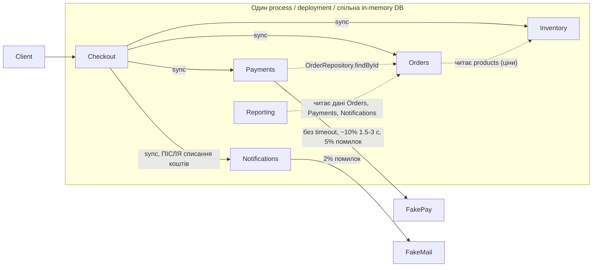

# OrderFlow: Architecture under Change. SOLUTION

Підхід: evolution plan, а не rewrite. Modular monolith залишається, посилюємо boundaries і прибираємо те, що найбільше збільшує cost of change. Складніші рішення (окремі сервіси) відкладаємо, доки немає evidence.

## 1. Current architecture



Суцільна лінія означає виклик між модулями, пунктир означає порушену межу.

**Відповідальності та залежності:**

| Модуль | Відповідальність | Залежності |
| --- | --- | --- |
| Checkout | Координує весь flow | Викликає Orders, Inventory, Payments, Notifications |
| Orders | Створення і статуси замовлення | Читає `products` Inventory для цін (leak) |
| Inventory | Резервування, idempotent reserve/release | Лише власні дані (добра межа) |
| Payments | Виклик провайдера, запис платежу | Читає `OrderRepository` Orders (leak), провайдер без timeout |
| Notifications | Email, шаблон у коді | Синхронно в critical path checkout |
| Reporting | Звіти | Напряму скан даних трьох модулів в одному process |

## 2. Proposed architecture

```mermaid
flowchart LR
    Client --> Checkout
    subgraph App["Той самий deployable + enforced boundaries"]
        Checkout -->|"sync"| Orders
        Checkout -->|"sync, idempotent"| Inventory
        Checkout -->|"sync, snapshot замовлення"| PayAPI
        subgraph Payments
            PayAPI --> Port["PaymentProvider port: timeout, circuit breaker"]
        end
        Checkout -. "OrderCompleted (async)" .-> Queue[(Queue)]
        Queue -.-> Notif["Notifications: retry, templates як config"]
        Reporting["Reporting: індекси + cache"] -->|public API| Orders
        Fit{{"Fitness function: scoped DB access у CI"}} -.-> App
    end
    Port --> FakePay
    Port -.->|"майбутній Provider B"| ProviderB
    Notif --> FakeMail
```

Пунктир означає async. Notifications більше не блокує відповідь клієнту, а Payments говорить із провайдером лише через port. Deployment boundary одна: ізоляцію даємо через контракти, а не через мережу.

## 3. Проблеми (evidence)

- **Метрики:** Modules Changed per Feature 1,7 → 4,3, Lead Time 2 → 6 днів, Rollback 2% → 9%, MTTR 35 → 95 хв, інцидентів 1 → 5/міс. 48% PR торкаються Orders і Payments, 37% змін шаблонів дають повний regression checkout.
- **Дефект у коді:** збій email після `complete()` потрапляє в загальний `catch`: stock повертається, order стає `FAILED`, а платіж лишається `CAPTURED`. Клієнт бачить помилку 503, хоча гроші вже списані, а Reporting усе одно рахує цей платіж у revenue. ≈1,9% checkout (0,95 × 0,02) за дефолтним конфігом. Жоден із 5 тестів цього не перевіряє, бо тестовий провайдер email ніколи не падає.
- **Boundary leaks:** Payments читає `OrderRepository`, Orders читає `products`, кожен модуль отримує всю `database`.
- **Checkout без захисту від провайдера:** немає timeout, а Notifications стоїть у critical path. Це збігається з двома останніми інцидентами (latency spikes провайдера).
- **Reporting** сканує дані в тому ж event loop на кожен запит, тому при зростанні навантаження в 8-10 разів (Scenario C) звіти конкуруватимуть із checkout за той самий процесор.

**Обмеження доказів:** метрики агреговані, кореляція не доводить причинності. Частина росту Deployment Duration пояснюється ручними approvals і більшим test suite, а не architecture.

Головні drivers cost of change: зв'язок Orders+Payments (одна зміна тягне два модулі), один deployment і regression на всіх (кожна дрібна правка проходить повний цикл), Notifications у critical path (збій email впливає на результат checkout).

## 4. Пріоритети architectural characteristics

1. **Checkout availability/resilience:** прямо revenue (Scenario E).
2. **Modifiability:** головна біль у метриках (Scenarios A, B, F).
3. **Data consistency Inventory/Payments:** без overselling (Scenario D).
4. **Deployability:** менший scope release і rollback.
5. **Scalability Reporting:** дані з відставанням у кілька хвилин прийнятні (Scenario C).

Чим поступаємося: миттєвістю email, свіжістю звітів, простотою інфраструктури. Це свідомий вибір: клієнт переживе лист із затримкою, але не переживе недоступний checkout, бо тоді бізнес втрачає замовлення, а не просто зручність. Саме тому availability стоїть вище за швидкість листа, а consistency вище за зручність асинхронності в Inventory.

## 5. Decision summary

**Problem.** Зміни зачіпають багато модулів (4,3 на feature), checkout залежить від повільного провайдера та email, а ще є дефект зі списанням грошей без COMPLETED order. Це проблема не одного модуля, а меж між ними.

**Decision (кожен крок прив'язаний до scenario):**
1. Виправити дефект: після `complete()` помилка email не робить `release` чи `fail`.
2. Payments приймає snapshot (`amountCents`, `currency`) замість `OrderRepository`.
3. Scoped database access з тестом (fitness function).
4. Notifications async, template і segmentation як config + feature flag (**Scenario A, E**).
5. Idempotency key → `PENDING` → timeout і circuit breaker → PaymentProvider port (**Scenario B, E**).
6. Reporting: індекси і cache замість скану (**Scenario C**).
7. Inventory idempotency не чіпаємо (**Scenario D**).

**Як це змінює типову зміну.** Візьмемо нове payment rule. Воно зараз зачіпає Payments, Orders, Checkout і Reporting та вимагає повного regression checkout. Після кроків 2-3 воно залишається в Payments (іноді Checkout), а тестується contract tests і smoke-тестом, тобто менше модулів, менше координації й вужчий regression. Зміна шаблону листа (Scenario A) стає зміною config без коду Orders/Payments, тому 37% випадків повного regression checkout для таких змін мають зникнути.

**Trade-offs.** Async email змінює контракт (`SENT` → `QUEUED`), тому 2 з 5 тестів (checkout і reporting) треба переписати. Також з'являється тихий failure mode: клієнт не отримав лист, а система вважає checkout успішним, тому retry і метрика `unsent` входять у рішення, а не додаються потім. **Non-obvious:** timeout без idempotency може призвести до подвійного списання (платіж пройде вже після нашого timeout, а ми повернули stock і клієнт повторив спробу), тому idempotency йде першою.

**Відхилено:** п'ять independent services з proposal. Команда 8+2, немає platform team, а Orders/Inventory/Payments потребують сильної consistency, тож мережа й partial failure потрапили б саме в revenue-critical шлях. Двоє senior engineers уже є bottleneck для review, і п'ять service ownership це лише посилили б. Кроки 1-3 proposal (contracts, data ownership, async) прийнято.

**Не змінюємо** (бо тут потрібні негайна відповідь і сильна consistency): Inventory (sync, idempotent), одну DB і один deployable для Orders/Inventory/Payments, Checkout як orchestrator, копії записів у `listProducts()` та `orders.list()` (хороший information hiding).

**Чи залишається modular monolith доречним?** Так: більшість проблем лежить у межах між модулями, а їх можна виправити без мережі між ними. **Перший кандидат на окремий deployable:** Notifications (найчастіші зміни, найслабша consistency-вимога), але лише коли будуть durable outbox, owner і моніторинг.

## 6. Principles

| Принцип | Де порушено зараз | Що змінюється |
| --- | --- | --- |
| Information Hiding | Payments знає `OrderRepository`, Orders читає `products` | Snapshot замість repository, scoped DB |
| Explicit Contracts | Checkout↔Notifications тримається на `status: SENT` | Контракт `OrderCompleted`, `PaymentProvider` port |
| Dependency Direction | Reporting і Payments залежать від даних інших модулів | Залежність лише від public API |
| Fitness Functions | Немає | Scoped-DB allowlist у CI |

Не все тут проблема. Принцип, який уже дотримано: **Information Hiding** у Inventory та в копіях записів, що повертаються назовні. Його переносимо на інші модулі: Payments, Orders і Reporting мають отримувати від сусідів лише копії даних або відповіді public API, а не доступ до сховища.

## 7. Ризики та metrics

| Risk | Probability | Impact | Expected cost | Mitigation |
| --- | --- | --- | --- | --- |
| Затримка/збій провайдера блокує checkout | 70% | $15k | $10,5k | Timeout, circuit breaker, `PENDING` |
| Подвійне списання при retry | 15% | $30k | $4,5k | Idempotency key |
| Втрата email через async (ризик рішення) | 25% | $4k | $1k | Retry, outbox, метрика `unsent` |

Probability за квартал, impact це оцінка (revenue даних немає), тому цифри слід замінити даними бізнесу. Важливіше за самі суми порядок ризиків: збій провайдера найімовірніший, і він уже стався двічі.

**Metrics:** Modules Changed per Feature 4,3 → <2,5. Change Lead Time 6 днів → ≤3. Rollback Rate 9% → <4%. Якщо після двох ітерацій перша метрика не падає, причина, ймовірно, в процесі чи ownership, а не в coupling, і план треба переглянути.

**Fitness function:** кожен модуль отримує `database` лише зі своїми колекціями, інакше тест падає. Import-тест тут не спрацював би, бо модулі імпортують лише `shared/*`, а зв'язки йдуть через DI.

```js
export function scopedDatabase(database, moduleName, allowed) {
  return new Proxy(database, {
    get(target, prop) {
      const value = Reflect.get(target, prop, target);
      if (typeof value === "function") return value.bind(target);
      if (typeof prop === "string" && prop in target && !allowed.includes(prop))
        throw new Error(`${moduleName} не має доступу до database.${prop}`);
      return value;
    }
  });
}
// payments: ["payments"] | notifications: ["notifications"] | inventory: ["products","inventoryOperations"]
```

## 8. Зв'язок зі scenarios

| Scenario | Stimulus | Response | Response measure |
| --- | --- | --- | --- |
| A | Marketing змінює template | Зміна config + flag | 0 змін коду Orders/Payments, вимкнення за секунди |
| B | Підключення Provider B | Новий adapter за `PaymentProvider` port | Один новий adapter, Checkout не змінюється |
| C | Reporting ×8-10 | Індекси + cache, звіти не блокують checkout | Checkout p95 без деградації під звітним навантаженням |
| D | Повторний reserve/release | Stock змінюється один раз | Тест duplicate reservation лишається зеленим |
| E | Провайдер 2-3 с або недоступний | Checkout завершується `PENDING`/`FAILED`, email не впливає | Checkout success rate ≥95% під spike |

## 9. Коли переглядати рішення

Окремий deployable для Notifications має сенс, коли є durable outbox, owner і моніторинг. Окремий read store для Reporting (власна копія даних для звітів) має сенс, якщо тест покаже вплив звітів на checkout навіть після індексів і cache. Payments виділяємо лише разом із другим provider з async confirmation або окремими security-вимогами. До того складніша архітектура не виправдана: вона додала б мережеві збої та on-call команді без platform team, не усунувши головних cost drivers.
